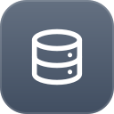
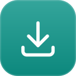
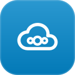
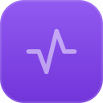
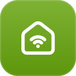
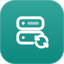
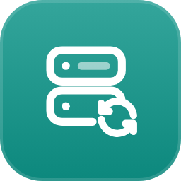

# Unraid Folder Icons

Animierte Ordner-Icons für [FolderView3](https://forums.unraid.net/topic/197223-plugin-folderview3/) auf Unraid.
Farbige Kacheln mit weißem Symbol und einer dezenten Animation, die direkt in der SVG steckt.
Sie funktionieren deshalb als ganz normales Bild-URL im Icon-Feld eines Ordners.

| | | | | | | |
|:-:|:-:|:-:|:-:|:-:|:-:|:-:|
| <br>`datenbanken` | <br>`netzwerk` | <br>`medien` | <br>`downloads` | <br>`youtube` | <br>`buecher` | <br>`nextcloud` |
| <br>`buero` | <br>`monitoring` | <br>`bunk-media` | <br>`weitara` | <br>`smart-home` | <br>`gaming` | <br>`backup` |

## Verwendung

In FolderView3 beim Ordner als Icon eintragen (feste Version, damit sich nichts unbemerkt ändert):

```
https://cdn.jsdelivr.net/gh/N0cky/unraid-folder-icons@v1.3.0/icons/<name>.svg
```

Wer `prefers-reduced-motion` aktiviert hat, bekommt die Icons ohne Animation.

## App-Icons

Für Container ohne brauchbares Logo und für Benachrichtigungen (z. B. ntfy) liegen statische
App-Icons in [`apps/`](apps/) (SVG + 256 px PNG, da Unraid Container-Icons als PNG cached):

| | |
|:-:|:-:|
| <br>`parse-dmarc` | <br>`nas-backup` |

```
https://cdn.jsdelivr.net/gh/N0cky/unraid-folder-icons@v1.2.0/apps/<name>.png
```

PNGs neu rendern: `CHROME=/pfad/zu/chrome ./render_apps.sh`

## Anpassen

Farben, Symbole und Animationen stehen in [`build.py`](build.py). Nach Änderungen neu erzeugen:

```
python build.py
```

`preview.html` zeigt alle Icons in FolderView3-Größe im hellen und dunklen Unraid-Theme
(z. B. mit `python -m http.server` im Repo-Ordner öffnen).

## Credits

- Symbole basieren auf [Tabler Icons](https://tabler.io/icons) (MIT-Lizenz).
- Idee der animierten Ordner-Icons: [hernandito](https://github.com/hernandito/unRAID-Docker-Folder-Animated-Icons---Alternate-Colors).
